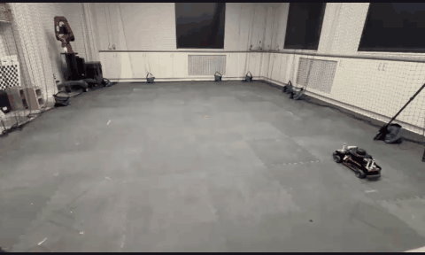
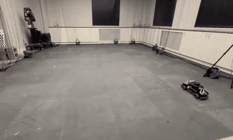
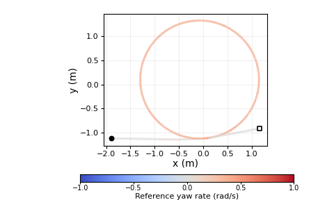
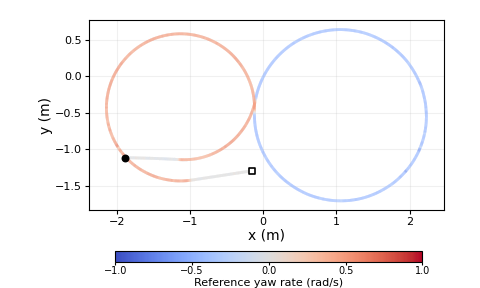
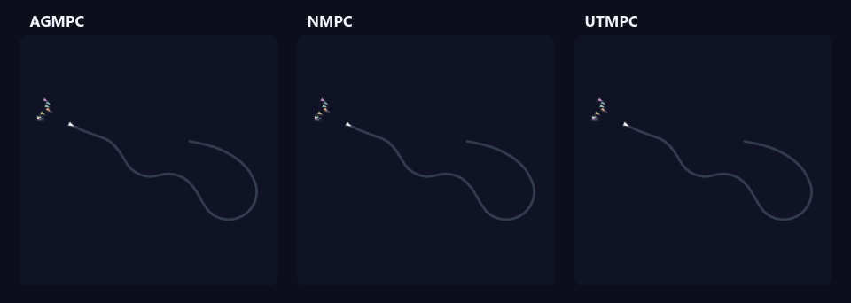

<table>
  <tr>
    <th>Circle</th>
    <th>Figure-eight</th>
    <th>Zigzag</th>
  </tr>
  <tr>
    <td align="center"></td>
    <td align="center"></td>
    <td align="center"></td>
  </tr>
  <tr>
    <td align="center"></td>
    <td align="center"></td>
    <td align="center"></td>
  </tr>
</table>

## Leader–follower framework

  

## Monte Carlo

  

