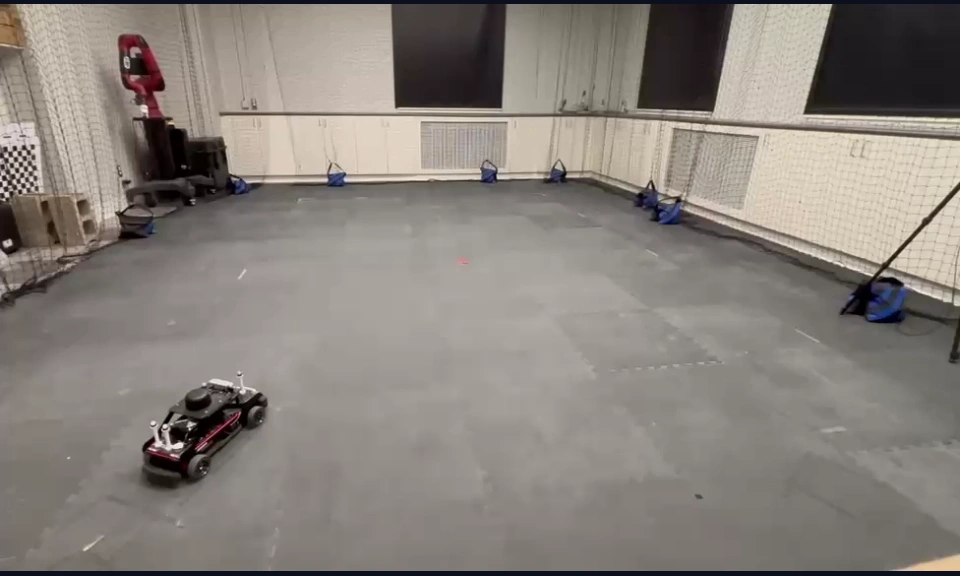
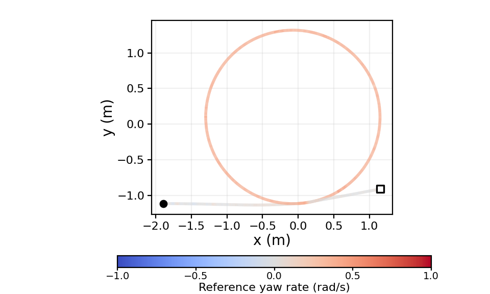
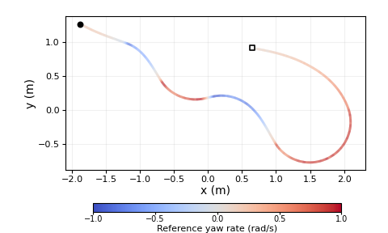
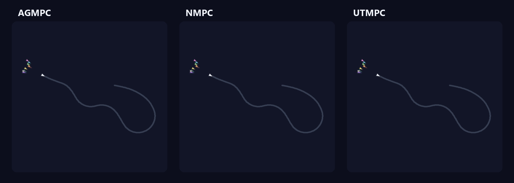
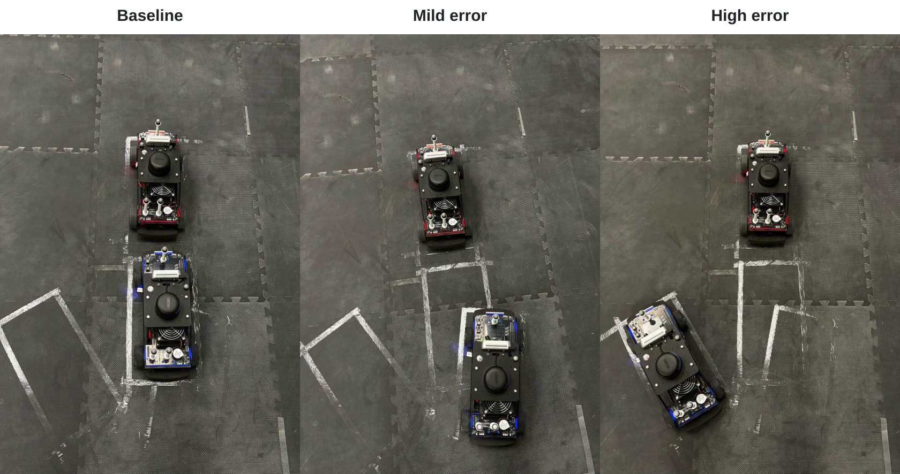

<h2 align="center">Trajectory Generation</h2>

<table align="center">
  <tr>
    <th align="center">Circle</th>
    <th align="center">Figure-eight</th>
    <th align="center">Zigzag</th>
  </tr>
  <tr>
    <td align="center"></td>
    <td align="center"></td>
    <td align="center"></td>
  </tr>
  <tr>
    <td align="center"></td>
    <td align="center"></td>
    <td align="center"></td>
  </tr>
</table>

<h2 align="center">Leader–Follower Waypoints Generation</h2>

  

<h2 align="center">Monte Carlo Results for the Zigzag Trajectory</h2>

  

<h2 align="center">Types of Error for the Physical Experiments</h2>

  

